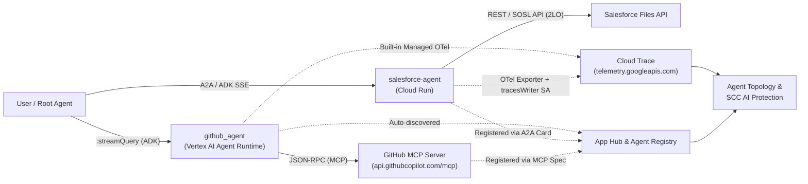

# Observe and Secure a Multi-Agent System — Step-by-Step Guide & Runbook

This repository contains the complete step-by-step guide, architecture overview, operational runbook, and automation script for the **Observe and Secure a Multi-Agent System** Google Cloud lab.

---

## Architecture Overview

In this lab, a multi-agent fleet spans multiple Google Cloud runtimes and external protocols:



### Fleet Components

| Component | Runtime / Hosting | Discovery Mechanism | Trace Export Mechanism |
|---|---|---|---|
| **`github_agent`** | Vertex AI Agent Runtime (`ReasoningEngine`) | Automatic via App Hub (`AGENT` functional type) & Agent Registry | Managed built-in telemetry (`GOOGLE_CLOUD_AGENT_ENGINE_ENABLE_TELEMETRY=true`) |
| **`salesforce-agent`** | Cloud Run (`salesforce-agent`) | Manual registration in Agent Registry using its A2A Agent Card (`a2a-agent-card`) | OpenTelemetry exporter (`get_gcp_exporters(enable_cloud_tracing=True)`) + `roles/telemetry.tracesWriter` on its Service Account |
| **`github-mcp`** | External MCP Server (`https://api.githubcopilot.com/mcp/`) | Manual registration in Agent Registry (`--mcp-server-spec-type=no-spec`, `JSONRPC`) | Observed via client-side `execute_tool` spans from `github_agent` |

---

## Repository Structure

```text
.
├── README.md                                  # Architecture & end-to-end overview
├── RUNBOOK.md                                 # Detailed step-by-step runbook (Tasks 1-10)
├── run_lab_solution.sh                        # Automated script to execute all lab tasks
└── reference/
    ├── salesforce_card.json                   # Sample A2A agent card fetched from salesforce-agent
    └── salesforce-agent/
        ├── pyproject.toml                     # ADK + OpenTelemetry dependencies (google-adk[gcp,otel-gcp])
        └── app/
            ├── agent.py                       # Salesforce specialist ADK agent definition
            └── app_utils/
                └── telemetry.py               # OpenTelemetry Cloud Trace & Cloud Logging setup
```

---

## Quick Start (Automated Execution)

To run all programmable steps (Tasks 1–5 and Tasks 7–9) automatically in Cloud Shell:

```bash
chmod +x run_lab_solution.sh
./run_lab_solution.sh
```

For detailed step-by-step instructions, explanations, verification commands, and console walkthroughs for every task, see **[RUNBOOK.md](./RUNBOOK.md)**.

---

## Summary of Tasks Completed

1. **Task 1 — Enable Observability & Discovery APIs**: Enabled `telemetry.googleapis.com`, `cloudtrace.googleapis.com`, `apphub.googleapis.com`, `agentregistry.googleapis.com`, and `discoveryengine.googleapis.com`.
2. **Task 2 — Export Traces to Cloud Trace**:
   - Verified `google-adk[gcp,otel-gcp]` in `pyproject.toml` and `get_gcp_exporters(enable_cloud_tracing=True)` in `app/app_utils/telemetry.py`.
   - Granted `roles/telemetry.tracesWriter` to the `salesforce-agent` Cloud Run service account (`PROJECT_NUMBER-compute@developer.gserviceaccount.com`).
   - Queried `github_agent` and `salesforce-agent` using `agents-cli run` and verified `invocation`, `invoke_agent`, `call_llm`, and `execute_tool` spans in Cloud Trace.
3. **Task 3 — Confirm Agent Runtime Auto-Discovery**:
   - Verified `github-agent` in Agent Registry (`gcloud alpha agent-registry agents list`).
   - Verified App Hub classifies the Reasoning Engine workload as `AGENT` via `discoveredWorkloads`.
4. **Task 4 — Register the Cloud Run Agent (`salesforce-agent`)**:
   - Provisioned the Discovery Engine service agent (`service-PROJECT_NUMBER@gcp-sa-discoveryengine.iam.gserviceaccount.com`) and granted it `roles/run.invoker` on `salesforce-agent`.
   - Downloaded the A2A agent card (`/a2a/app/.well-known/agent-card.json`) and registered `salesforce-agent` in Agent Registry with `--agent-spec-type=a2a-agent-card`.
5. **Task 5 — Register the GitHub MCP Server (`github-mcp`)**:
   - Registered `github-mcp` in Agent Registry with `--mcp-server-spec-type=no-spec` and `--interfaces="url=https://api.githubcopilot.com/mcp/,protocolBinding=JSONRPC"`.
6. **Task 6 — View the Agent Topology Graph**:
   - Inspected the unified multi-runtime topology graph in **Agent Platform > Agent Registry > Agents > Topology**.
7. **Tasks 7 & 8 — Identify Excessive Permissions in SCC AI Protection & Policy Analyzer**:
   - Inspected the over-privileged `salesforce-agent` service account (`roles/editor`) in **Agent Platform > Security** and proved resource blast radius with **IAM Policy Analyzer**.
8. **Task 9 — Remediate Service Account to Least Privilege**:
   - Ensured narrow operational roles (`roles/aiplatform.user`, `roles/telemetry.tracesWriter`, `roles/logging.logWriter`, `roles/cloudtrace.agent`) were bound to the `salesforce-agent` service account.
   - Removed the broad `roles/editor` binding and verified removal against the live IAM policy.
9. **Task 10 — (Optional) Trigger & View Agent Runtime Threat Detection**:
   - Reviewed runtime threat detection capabilities in Security Command Center AI Protection.
